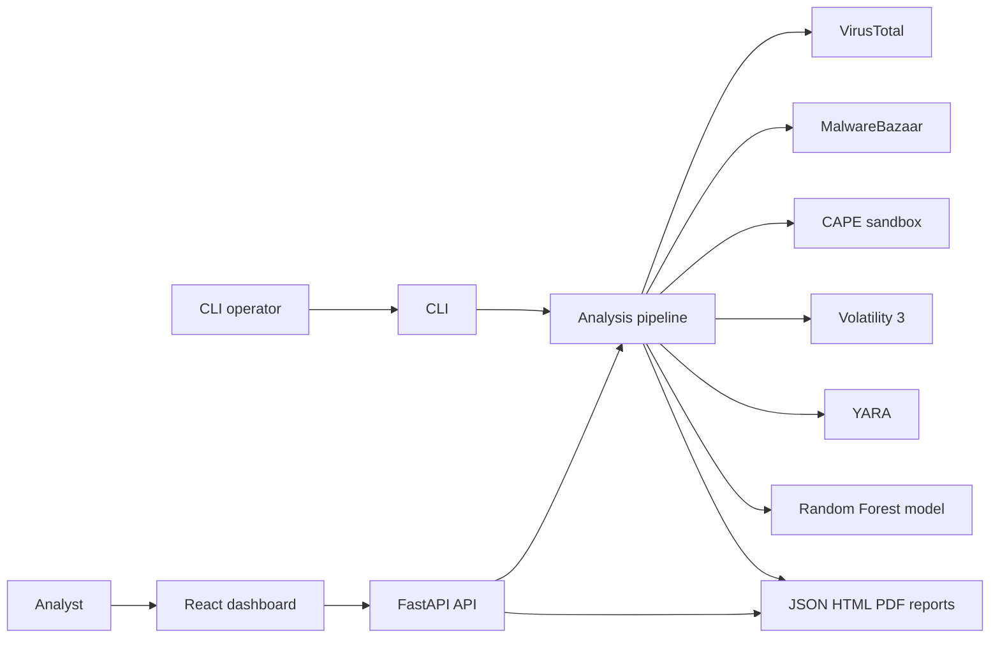
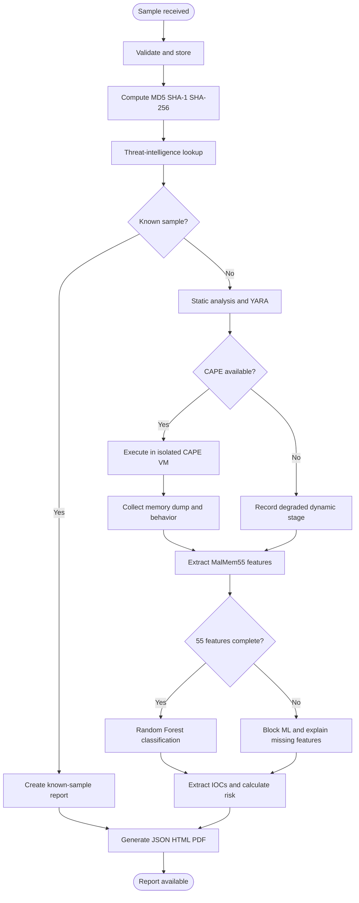
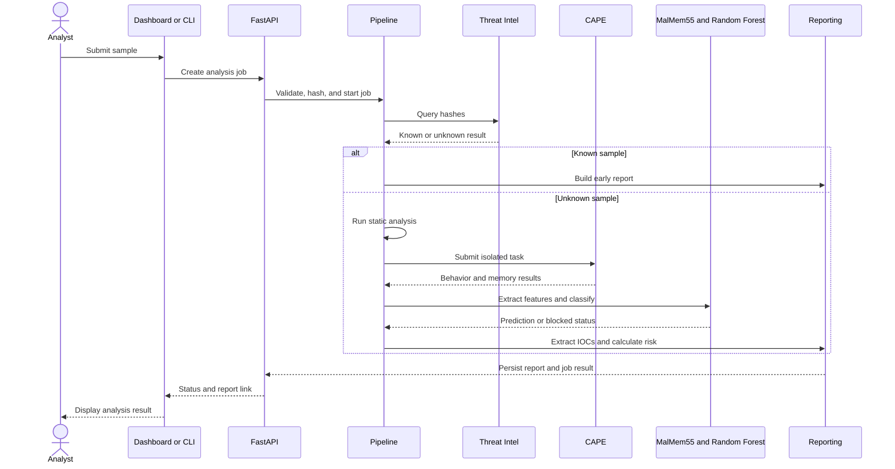
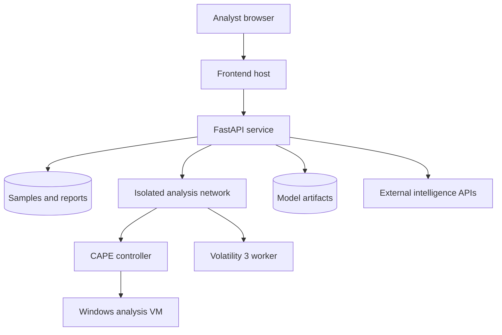
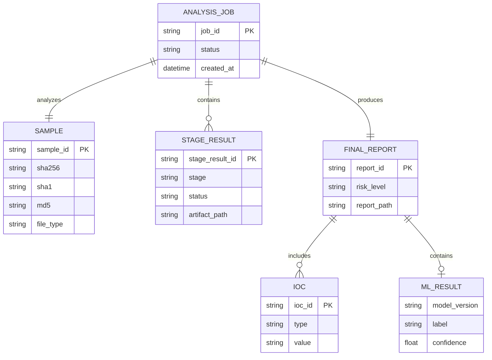

# System Diagrams

These Mermaid diagrams describe the current platform boundary and are the visual companion to `docs/SRS.md`.

## System Context

## End-to-End Activity

## Analysis Sequence

## Deployment View

## Report Data Model

Update these diagrams when pipeline stages, trust boundaries, persistence contracts, or report fields change.