# AI-VulnScan Architecture

This document describes the connected implementation. The editable Mermaid source is `architecture.mmd`; `architecture.svg` is a portrait rendering styled after the supplied reference.

## Runtime pipeline

```mermaid
flowchart TB
    U["1 · User input<br/>IP · hostname · strict CIDR"]
    V["2 · Input validation<br/>address, CIDR, port, profile and scope caps"]
    N["3 · Nmap scan engine<br/>argv subprocess · timeout · explicit authorization"]
    X["4 · Nmap XML parser<br/>host, port, state, service, CPE, script and OS observations"]
    F["5 · Service fingerprinting<br/>Nmap evidence; optional one-request HTTP probe"]
    R["6 · Vulnerability rule engine<br/>deterministic potential findings"]
    E["7 · Evidence engine<br/>quality, confidence, source and uncertainty"]
    C["8 · NVD CVE lookup<br/>candidate → CPE/product/version status"]
    A["9 · Local AI analyzer<br/>optional Ollama; advisory only"]
    S["10 · Deterministic risk scoring<br/>0–100; independent of AI"]
    Q["11 · Explainable AI / evidence explanation<br/>facts, CVEs, uncertainty, risk factors"]
    M["12 · Recommendation engine<br/>evidence-linked; never executes changes"]
    G["13 · Report generator<br/>Markdown · JSON · HTML"]
    H["14 · Scan storage and comparison<br/>atomic JSON history · conservative diff"]
    U --> V --> N --> X --> F --> R --> E --> C --> A --> S --> Q --> M --> G --> H
    H -. "load two saved scans" .-> H
    classDef normal fill:#0b1d3a,stroke:#e6f2ff,color:#f6fbff,stroke-width:2px;
    classDef ai fill:#062c4b,stroke:#00d9f5,color:#00eaff,stroke-width:2px;
    class U,V,N,X,F,R,E,C,S,M,G,H normal;
    class A,Q ai;
```

Risk scoring runs after AI analysis in the orchestration order only to keep the AI input focused on observed evidence; the risk engine does not consume AI scores or text. Explanations are built after scoring so they can cite the deterministic factors. AI output is attached afterward as a clearly labeled, non-authoritative interpretation.

## Module responsibilities and contracts

| Module | Contract |
|---|---|
| `main.py` | CLI target/profile/ports, scope display, exact authorization and multi-host confirmation, profile-specific warning, scan/report/history UX. |
| `scanner.py` | `scan_target(...) -> dict`; validates before scanning, requires `authorized=True`, requires explicit multi-host confirmation, uses bounded argv-based Nmap, returns status/errors/XML/host/service summary. |
| `nmap_xml_parser.py` | `parse_nmap_xml(str) -> dict`; normalizes XML and preserves open, filtered, open\|filtered, service, CPE, script, OS, and completion data. Malformed XML raises a typed parse error. |
| `fingerprint_engine.py` | Adds fingerprint provenance/confidence without replacing Nmap values. HTTP GET is off by default and opt-in. |
| `rule_engine.py` | Produces deterministic potential findings only for matching confirmed-open observations. |
| `evidence_engine.py` | Enriches each service with detection/version evidence quality and explicit uncertainty. |
| `cve_lookup.py` | NVD API 2.0 lookup, bounded retry/in-memory cache, CPE vendor/product identity and supported exact version-boundary comparison. All results are non-confirmatory. |
| `ai_analyzer.py` | Checks Ollama tags and model, sends bounded structured evidence to `/api/chat`, returns explicit `completed`, `model_not_found`, or `unavailable`. |
| `risk_engine.py` | Stable 0–100 scoring, documented category thresholds, stored factors; AI output is not an input. |
| `explainability_engine.py` | Ties rule/CVE/evidence/risk facts and uncertainty together; AI is a separate labeled field. |
| `recommendation_engine.py` | Creates evidence-linked suggested/general guidance; no remediation command is executed. |
| `config_auditor.py` | Reviews only selected response headers actually collected by an opt-in HTTP probe; skipped checks are not reported as failed checks. |
| `report_generator.py` | Generates non-overwriting, escaped Markdown/JSON/HTML reports. |
| `scan_storage.py` | Stores structured JSON and optional raw XML under unique IDs; records report locations and lists corrupt records with warnings. |
| `scan_comparator.py` | Compares same-scope/completed/profile-compatible scans and states when absent data is not evidence of remediation. |

## Port-state and finding semantics

- `open` is the only state eligible for service rules and NVD lookup.
- `filtered`, `open|filtered`, `closed|filtered`, and other states are retained as observations but are not upgraded to open.
- Rule findings are `potential`; NVD keyword matches are `candidate`. A `version_match` means a listed vulnerable CPE entry matches supported version evidence, not confirmed exploitability.
- A CVE is not marked `applicability_verified` by the current implementation.
- Evidence confidence, NVD applicability status, AI interpretation, severity, and deterministic risk are separately represented.

## Scope and network boundary

The interactive CLI defaults to `127.0.0.1`, prints the full requested scope, and requires explicit `YES` confirmation. CIDRs are strict network addresses and are limited by `MAX_CIDR_SIZE` and `MAX_HOST_COUNT`; scanning multiple addresses also requires an exact host-count confirmation. No DNS resolution occurs during validation. Nmap receives a target only after these checks. The scanner does not invoke a shell, run as root, enable NSE vulnerability scripts, or perform an automatic remediation action.

## Persistence and external services

- NVD is an external HTTPS dependency for CVE candidates; failures are retained in scan errors.
- Ollama is an optional local service; missing service/model does not block reports.
- Scan history uses the existing atomic JSON-file layout plus optional raw XML, not SQLite.
- Reports and scan records may contain sensitive target and service information; protect those directories.
